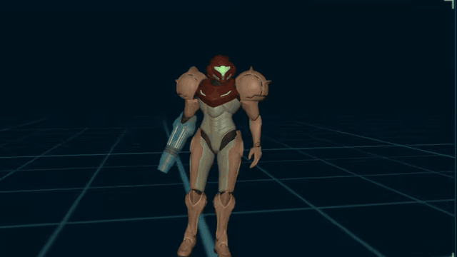
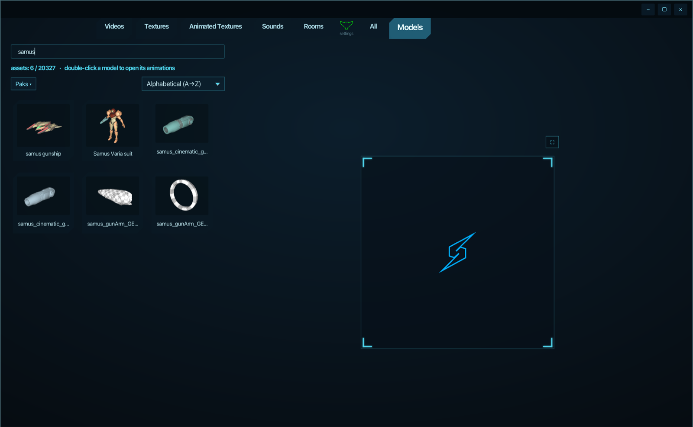
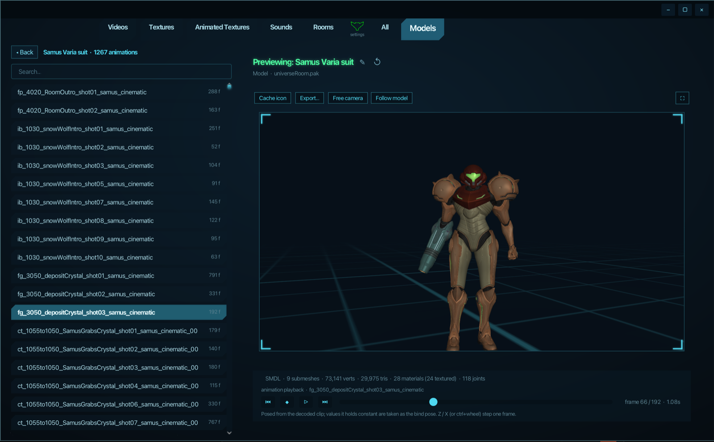

<div align="center">


# Mocktroid

**An all-in-one asset viewer for *Metroid Prime 4: Beyond*.**

Point it at a romfs dump and browse textures, 3D models, animations, sounds and videos straight from the game's `.pak` files. No extracting or converting first.


</div>

---

> **Mocktroid does not include any game data.** You need your own legally obtained dump of the game's romfs. This is an unofficial fan project and is not affiliated with or endorsed by Nintendo or Retro Studios.

<div align="center">

[](assets/demo.mp4)

<sub>Character animation playback in the model viewer. Click for the full-quality video.</sub>

</div>

<br />


<sub>Search and browse every model in the romfs, with cached thumbnails in grid view.</sub>


<sub>Double-click a model to list its animation clips and play them on the skinned model.</sub>

## Features

- **PAK browser** - reads all 441 paks (about 90,000 assets) directly, including the game's custom LZSS/Huffman compression. List or grid view, search, per-pak filter and sorting.
- **Textures (TXTR)** - Tegra block-linear deswizzling and BC1-7 / BC6H / ASTC decoding. Mip, layer, cube-face and 3D-slice selection, channel isolation, HDR exposure, zoom/pan, PNG export. Flipbook playback for animated 2D-array textures, with GIF/WebP export.
- **Models (CMDL / SMDL)** - JavaFX 3D preview with orbit/pan/zoom, free camera, wireframe, custom skybox and floor grid. Base colour, normal, metal/roughness and glow maps, plus bone overlay for skinned models.
- **Character animations (CHPR)** - double-click a model to browse its animation clips and watch them play on the CPU-skinned model at 60 fps. Clip data is decoded with a bit-packed stream decoder reverse-engineered from the game itself. See [`Explanation.txt`](docs/Explanation.txt).
- **Sounds (CSMP)** - decoded with `vgmstream-cli`, with waveform view, loop markers, loop count, autoplay and duration sorting.
- **Videos (FMV0)** - plays the game's embedded MP4s (WebM ones are converted via `ffmpeg`).
- **Export** - models to OBJ/MTL or glTF 2.0, sounds to WAV/FLAC/OGG/MP3, videos to MP4, animated textures to GIF/WebP.
- **Quality-of-life** - thumbnail and waveform caches, derived asset names (from skin, material and string tables), custom renames keyed by GUID (import/export supported), update-romfs overlay support, and a custom-chrome window styled after the game's Logbook.

## Requirements

| Requirement | Notes |
|---|---|
| **JDK 21 or newer** | Required to build from source (the downloads bundle Java) |
| **Maven** | Optional, the bundled wrapper (`source/mvnw`) downloads it if you don't have it |
| **A romfs dump of the game** | Required |
| [`vgmstream-cli`](https://github.com/vgmstream/vgmstream) | Optional, needed for sound previews and sound export. Auto-detected on `PATH` or in `./tools/vgmstream`, or set it in **Settings > Audio** |
| [`ffmpeg`](https://ffmpeg.org/) | Optional, needed for the one WebM video and for FLAC/OGG/MP3/WebP export |

## Download (easiest)

Grab the zip for your system from the [**Releases**](https://github.com/Infinite00857/Mocktroid/releases) page. Java is bundled, so there is nothing else to install:

| System | File | How to open |
|---|---|---|
| **Windows** | `Mocktroid-*-windows-x64.zip` | Unzip, then run `Mocktroid\Mocktroid.exe` |
| **macOS (Apple Silicon)** | `Mocktroid-*-macos-arm64.zip` | Unzip, then right-click `Mocktroid.app` > **Open** the first time (the app isn't signed). If macOS says it's damaged, run `xattr -dr com.apple.quarantine Mocktroid.app` |
| **macOS (Intel)** | `Mocktroid-*-macos-x64.zip` | Same as above |
| **Linux** | `Mocktroid-*-linux-x64.zip` | Unzip, then run `Mocktroid/bin/Mocktroid` |

Optional extras: install [`vgmstream-cli`](https://github.com/vgmstream/vgmstream) for sound previews and [`ffmpeg`](https://ffmpeg.org/) for the WebM video and extra export formats.

The zips are built automatically by GitHub Actions (`.github/workflows/release.yml`) for every version tag. The newest build of `main` is also under the **Actions** tab (open the latest run, then **Artifacts**).

## Building from source

You only need a **JDK 21 or newer** ([Adoptium](https://adoptium.net)). Maven is optional: the launch scripts use your installed Maven, or else the bundled Maven wrapper, which downloads it the first time.

```bash
git clone https://github.com/Infinite00857/Mocktroid.git
cd Mocktroid
```

### Quick launch

Each script builds if needed and starts the app:

| Platform | Command |
|---|---|
| **macOS** | Double-click `Run Mocktroid.command` (or run it in a terminal). Homebrew setup: `brew install openjdk@21 maven vgmstream ffmpeg` |
| **Linux** | `./"Run Mocktroid.sh"` (`sudo apt install openjdk-21-jdk maven`) |
| **Windows** | Double-click `Run Mocktroid.bat`. It finds Java and Maven via `PATH` (or `JAVA_HOME` / `MVN`) |

On macOS/Linux you may need to `chmod +x` the scripts first. On Windows, if Java or Maven aren't on your `PATH`, create a `Run Mocktroid.local.bat` next to the launcher that sets `JAVA_HOME` and/or `MVN`. It's git-ignored, and the header of `Run Mocktroid.bat` has an example.

### Or run with Maven directly

```bash
mvn -f source/pom.xml compile javafx:run      # or: source/mvnw -f source/pom.xml compile javafx:run
```

### Build a standalone jar

```bash
mvn -f source/pom.xml package
# -> source/target/mocktroid.jar (with all dependencies bundled)
```

## First run

1. **Pick your romfs folder.** Required; Mocktroid won't continue without a valid pak layout.
2. **Choose whether to build the model thumbnail cache.** This can take a while, so you can skip it. Thumbnails are also generated lazily as you scroll.
3. **Choose List or Grid** as your default browse mode. You can change it later in Settings.

Everything else lives in **Settings** (the visor icon in the tab bar): romfs and update-romfs paths, render resolution, skybox, animation speed, UI sounds, cache management and more.

### Using the game's update

The game's `update.nsp` is encrypted and can't be read directly. Dump the update's romfs with an emulator and point **Settings > General > Update RomFS Path** at it. Its paks replace the base paks at the same relative path.

## Controls

**Model viewport**

| Input | Action |
|---|---|
| Left-drag | Orbit |
| `Ctrl` + left-drag / middle-drag | Pan |
| Scroll | Zoom |
| `W` `A` `S` `D` | Move along the view |
| `Q` / `E` | Down / up |
| `Shift` | Move faster (`Shift` + scroll changes the multiplier) |
| `Space` | Play / pause |
| `Z` / `X` or `Ctrl` + scroll | Previous / next frame |
| `F2` | Rename selected asset |

## Project layout

```
Mocktroid/
├── source/                  Maven project (Java 21, JavaFX)
│   ├── pom.xml
│   ├── tools/gen_bcn.py     Generates the BC6H/BC7 lookup tables
│   └── src/main/java/com/mocktroid/
│       ├── format/          Binary format readers: pack, compress, texture, model, chpr, audio, video
│       ├── library/         Romfs catalog, name index, caches, model/skeleton loading
│       ├── ui/              Window chrome, browse views, preview panes
│       ├── audio/           Sound playback and UI sounds
│       ├── export/          OBJ / glTF / audio / video / GIF exporters
│       └── settings/        Persisted settings
├── assets/                  Art used by the app, plus the screenshots and demo video in this README
├── docs/                    Dev notes and file format write-ups
│   ├── Explanation.txt      What's been learned about the game's file formats
│   ├── roadmap.md           Detailed dev notes, module status and open work
│   └── *-format.txt, ...    Notes on single formats (CHPR, ROOM) and findings
└── Run Mocktroid.*          Launch scripts
```

## Status

Mocktroid is under active development. Roughly:

| Area | Status |
|---|---|
| PAK reading and decompression | Done, verified against all 441 paks |
| Textures | Done, all 13,173 textures decode without failures |
| Models and skeleton overlay | Done, 19,801 of 19,803 CMDLs and all 524 SMDLs parse (2 CMDLs use an unknown compression mode) |
| Sounds and videos | Done |
| Character animation | Working, still being refined (some rigs and fingers pose incorrectly) |
| Materials / ROOM preview | Not started |
| Cinematic viewer | Planned |
| Ready-to-run downloads (`jpackage`) | Built by GitHub Actions for Windows, macOS and Linux |

See [`roadmap.md`](docs/roadmap.md) for the full module list and open issues.

## File format research

The game's formats are mostly packed binary with no labels. [`Explanation.txt`](docs/Explanation.txt) documents what's understood so far (paks, textures, models and materials, skeletons, animation clips, videos, sounds) and how each piece was worked out. Parts are verified against the whole romfs, while others are marked as educated guesses.

## Credits

- [retrotool](https://github.com/encounter/retrotool) (MP4 branch) - reference for the pak, texture and model layouts
- **mp4x** - reference for character (CHPR) layouts
- [vgmstream](https://github.com/vgmstream/vgmstream) - CSMP audio decoding
- [bcdec](https://github.com/iOrange/bcdec) - basis for the BC1-7 decoders
- ASTC decoder written from the Khronos specification

## License

Released under the [MIT License](LICENSE).

*Metroid Prime 4: Beyond* and all related names and assets are property of Nintendo. This project contains none of them.
